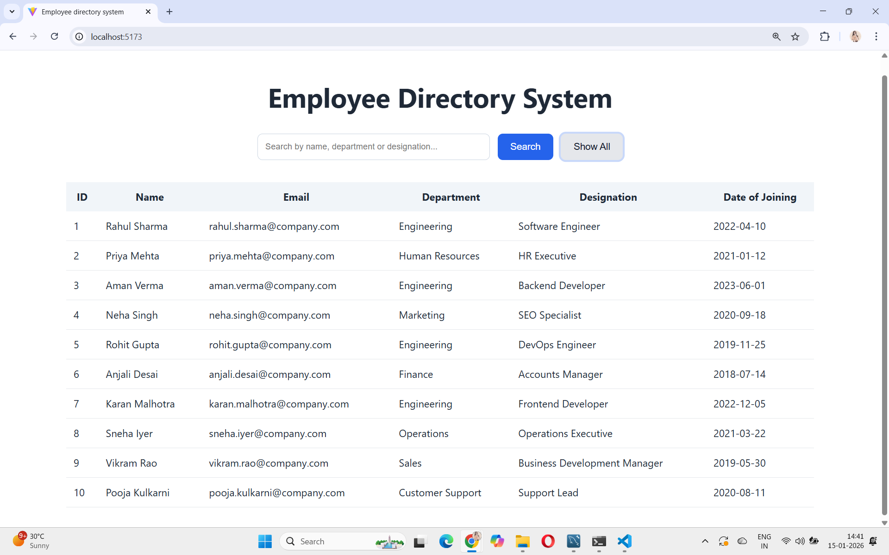
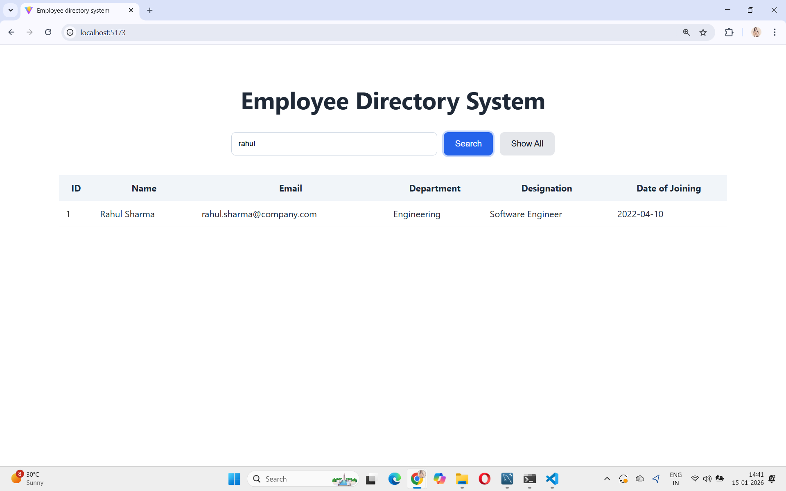
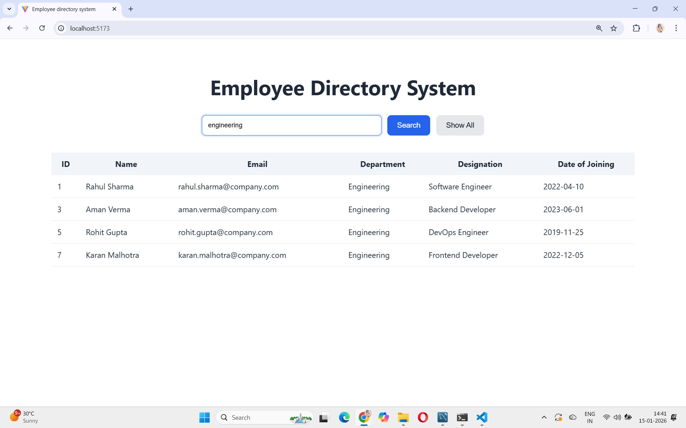
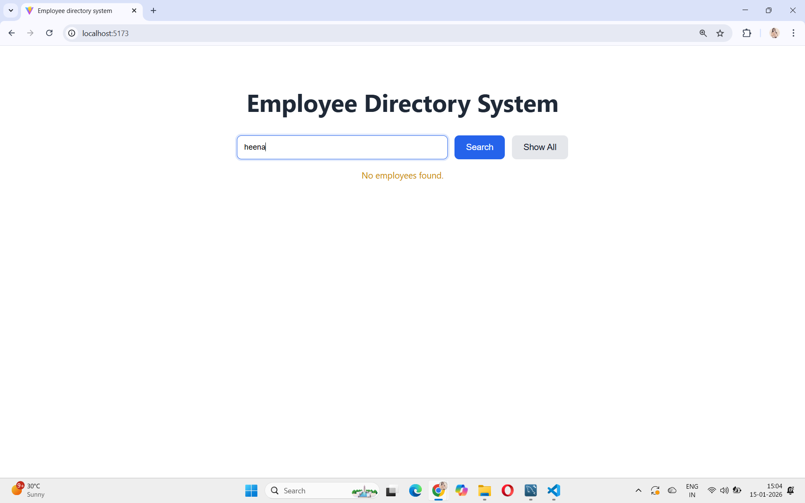

Employee Directory Search System

A full-stack employee directory built with React + Vite and FastAPI + MySQL.
It allows users to search and view employees by name, department, or designation.

Features:
1. Search employees (name / department / designation)
2. Show all employees
3. Optimized API usage (no calls on every keystroke)
4. Loading, error, and no-data states
5. Clean backend architecture (Router → Service → Repository → DB)
6. Environment-based configuration

Tech Stack:
Frontend: React, Vite, Axios
Backend: FastAPI, SQLAlchemy, MySQL

Setup:
Backend:
cd backend
python -m venv venv
venv\Scripts\activate
pip install -r requirements.txt
python -m uvicorn app.main:app --reload

Frontend:
cd frontend
npm install
npm run dev

Create .env files using .env.example.

Database:
CREATE TABLE employees (
  id INT PRIMARY KEY AUTO_INCREMENT,
  name VARCHAR(100),
  email VARCHAR(120) UNIQUE,
  department VARCHAR(100),
  designation VARCHAR(100),
  date_of_joining DATE,
  INDEX(name),
  INDEX(department)
);

Search Optimization:
1. Search only on Enter / Search click
2. Indexed columns
3. Database-level filtering

